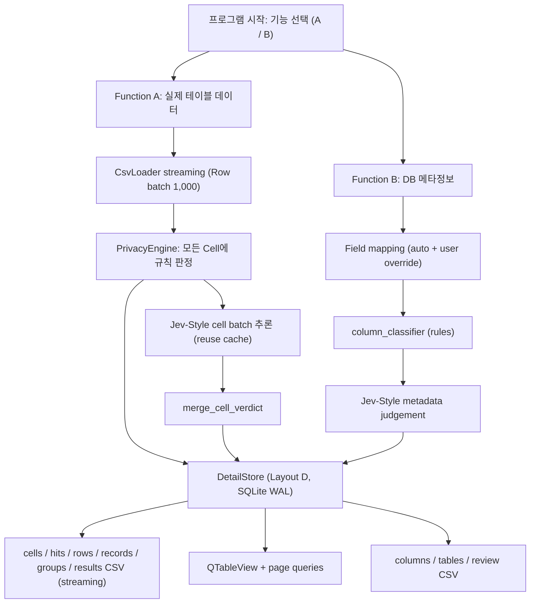

# Privacy Scanner — 두 분석 기능 완전 분리 설계 (Function A / Function B)

- 기준: v0.7.0 릴리스 소스 (commit `50c4945` (v0.6.0) 위에 Function A/B 분리·Cell-Level 판정·Layout D·PII Grouping·QThread Worker·PagedTableModel 작업)
- 상태: **구현·검증 완료, v0.7.0 릴리스** (manifest 재생성, split bundle rebuild, tag/Release_upload 포함)
- 모든 수치는 이 저장소·이 환경(macOS Apple Silicon, Python 3.15, Jev-Style 0.8B-v3 Metal)에서 **실실행 측정**한 값. 미실행 항목은 "미검증"으로 표시

---

## 0. 설계 결론 (4 lines)

1. Function A(실제 테이블 데이터)와 Function B(DB 메타정보)는 **UI·입력검증·파이프라인·데이터모델·보고서** 전체를 분리한다. 공유하는 것은 SQLite 저장, 마스킹, 로그, CSV 읽기, AI runtime, 탐지기 프레임워크뿐이다.
2. A의 판정 단위은 **Cell**, B의 판정 단위은 **Column/Table**이다. B에는 Cell 개념이 없다.
3. 실측: 150,000 × 200 = 30M Cell에서 현재의 `cell_verdict` 텍스트 ledger는 **SQLite 10.34 GB**이다. → **Row 단위 status BLOB(1 byte/column) + detail table** 설계로 **562 MB**(-94.5%)로 줄인다. `KEY 제외`는 bitmap code로 완전 derive(저장 0 byte).
4. AI Cell 추론 실측 = **21.8 Cell/s**. 150k×20파일에서 규칙 미확정 Cell 300,000개 → 무제한 AI pass는 **≈3.8 h**. 따라서 **문맥 키 기반 판정 reuse + AI budget + 미판정 Cell은 `미평가` 유지**가 설계 강제 조건이다.

---

## 1. 현재 구현 inventory (코드 근거)

### 1.1 존재하는 기능

| 영역 | 코드 | 동작 |
|---|---|---|
| 단일 분석 파이프라인 | [analyse_file()](/Users/gomin/Workspace/piiscan/app/core/analysis_service.py) | 파일 → 형식감지 → 규칙 → Row 분석 → 집계 → Export |
| Cell 단위 판정 | [cell_verdict.py](/Users/gomin/Workspace/piiscan/app/core/cell_verdict.py), [process_batch()](/Users/gomin/Workspace/piiscan/app/core/privacy_engine.py) | 5 상태, Cell 1개 = 1 record |
| 2단계 판정 | `finalise_verdicts()` | 매칭 Cell `미평가` 보관 → 컬럼 완성 후 확정(Row 순서 독립) |
| 규칙+AI 병합 | `merge_cell_verdict()` | AI는 규칙 확정 `개인정보` 삭제 불가, 충돌 시 `검토 필요` |
| SQLite ledger | [detail_store.py](/Users/gomin/Workspace/piiscan/app/core/detail_store.py) | `cell_verdict`, `cell_detail`, `row_verdict`, `row_detail`, WAL, batch insert |
| Cell batch AI | [decision.py](/Users/gomin/Workspace/piiscan/app/ai/jev/decision.py), `engine.judge_cells()` | shared state 1 + Cell question → Cell verdict |
| Streaming export | [hit_exporter.py](/Users/gomin/Workspace/piiscan/app/export/hit_exporter.py) | `iter_hit_cells()`, `iter_verdict_cells()`, `iter_row_records()` |
| GUI Worker | [analysis_worker.py](/Users/gomin/Workspace/piiscan/app/ui/analysis_worker.py) | `AnalysisWorker(QThread)` + progress/cancel |
| Paged 조회 | [table_model.py](/Users/gomin/Workspace/piiscan/app/ui/table_model.py), `result_window._show_cell_page()` | SQLite 200 Cell page |
| CLI | [main.py](/Users/gomin/Workspace/piiscan/app/main.py) | `--mode auto|sampling|full`, AI cell flags |

### 1.2 존재하지 않는 기능

| 명세 요구 | 코드 확인 | 분류 |
|---|---|---|
| 진입 화면 분석 유형 선택 | 바로 "파일 분석" tab([main_window.py:47-62](/Users/gomin/Workspace/piiscan/app/ui/main_window.py)) | **미구현** |
| KEY 컬럼 사용자 지정(단일/복합/변경) | `key` 관련 코드 없음 | **미구현** |
| `KEY 제외` Cell 상태 | `STATUSES` 5개뿐([cell_verdict.py:23-29](/Users/gomin/Workspace/piiscan/app/core/cell_verdict.py)) | **미구현** |
| Cell identity `analysis_id+table_id+row_key+column_index` | PK `(analysis_id,row,column_index)`; `table`은 config 문자열 | **부분** |
| 동일 개인정보 그룹(HMAC·occurrence·record수·KEY list) | 없음(`code_group_analyzer`는 코드 체계 분석) | **미구현** |
| DB 메타정보 분석 | `app/metadata_analysis/` 없음 | **미구현** |
| Function B 보고서 | 없음 | **미구현** |
| 이력에서 유형 구분 | 5 columns: 분석일시/파일/행 수/개인정보 컬럼/위험도 | **부분** |
| Cell 판정 reuse cache(문맥 고려) | 같은 batch state만 reuse([analysis_service.py:273+](/Users/gomin/Workspace/piiscan/app/core/analysis_service.py)) | **미구현** |
| 150k×20/50/100/200, B 5,000 benchmark | 없음(임시 probe만) | **미구현** |

### 1.3 재사용 / 분리 / 제거

**공통 layer 재사용**
`app/utils/{masking,csv_safety,validators,hyperloglog,logger}.py`, `app/core/{csv_loader,csv_detector}.py`, `app/ai/jev/*`, `app/detectors/base.py`(Detector contract + `column_affinity` + `ValueProfile`)

**Function A 전용으로 분리**
`privacy_engine.py`, `row_analysis.py`, `result_aggregator.py`, `risk_engine.py`, `encryption_analyzer.py`, `code_group_analyzer.py`, `hit_exporter.py`

**Function B 전용(신규)**
metadata intake, field mapping, table classifier, column classifier, B report writer

**제거·역할 변경**
- `analysis_service.analyse_file()`의 "범용 엔진" 역할 → A/B entry로 분리
- Function A의 Row 기반 AI → **KEY 레코드(record)** 단위 AI. KEY없을 때만 Row번호 fallback
- `--mode auto|sampling|full`의 Cell 범위 축약 기능 제거. Cell scope는 **항상 전수**. sampling은 **AI 예산**개념으로만 존재
- `cell_detail`(hit cells)와 `cell_verdict`(all cells) 중복 저장 → compact layout으로 통합

---

## 2. Target architecture

```mermaid
flowchart TD
  E[시작: 분석 유형 카드 A | B]
  E -->|A| AI[data_analysis/input: 테이블 CSV/TXT intake + preview]
  E -->|B| BI[metadata_analysis/input: 메타정보 intake]
  AI --> AK[key_selection: KEY single/composite]
  AK --> AC[cell_analysis: rule -> AI -> final verdict]
  AC --> AG[grouping: HMAC fingerprint groups]
  AG --> AR[A reports: cells / records / columns / groups / rows]
  BI --> BT[table_analysis]
  BI --> BC[column_analysis]
  BT --> BR[B reports: tables / columns / review lists]
  AC -. shared .- CS[app/core: DetailStore, csv, masking, logging]
  BT -. shared .- CS
  BC -. shared .- CS
  AC -. shared .- AIm[app/ai runtime]
  BC -. shared .- AIm
```

```
app/
  data_analysis/
    input/            table_input.py, preview.py
    key_selection/    key_selector.py, record_key.py
    cell_analysis/    cell_rules.py, cell_ai.py, verdict.py
    grouping/         pii_group.py
    reports/          a_reports.py
  metadata_analysis/
    input/            metadata_input.py, field_map.py
    table_analysis/   table_score.py
    column_analysis/  column_score.py
    reports/          b_reports.py
  core/               detail_store.py, csv_loader.py, csv_detector.py, cell_verdict.py   # shared
  ai/                 unchanged runtime
  utils/              unchanged
  ui/
    mode_select.py    new entry screen
    data_ui.py        Function A flow
    metadata_ui.py    Function B flow
    analysis_worker.py, table_model.py, lifecycle.py   shared, mode-aware
```

CLI entry: `--mode table` (default GUI launcher) / `--mode metadata`; per-mode flags mutually exclusive.

---

## 3. Function A — 실제 테이블 데이터 분석

### 3.1 화면 흐름

```mermaid
flowchart TD
  A1[파일 선택] --> A2[미리보기 20행 (masked)]
  A2 --> A3[KEY 컬럼 지정<br/>단일 / 복합 / KEY 없음]
  A3 --> A4[Cell 분석 (QThread Worker)<br/>Row / Cell / AI / RAM 실시간 + 취소]
  A4 --> A5[Cell ledger | KEY record | 유형별 컬럼 | 그룹 | Row 현황]
```

- 페이지 size 기본 200, Cell detail는 선택 Row만 lazy load(current `result_window` 구조 유지)
- 분석 중 창 이동·다른 tab 조작 가능(QThread + signal/slot)

### 3.2 Cell 상태 (6개)

| 상태 | 의미 | 저장 |
|---|---|---|
| `개인정보` | 규칙 또는 AI 확정 | status + detail |
| `검토 필요` | 근거 있으나 미확정 | status + detail |
| `비개인정보` | 규칙이 긍정적으로 제외 | status + 축약 근거 |
| `미평가` | 규칙 미매칭 + AI 미판정 | status(근거 없음) |
| `빈 셀` | 원문 없음 | status code only |
| `KEY 제외` | KEY 컬럼 | **derive**(저장 0 byte) |

Cell scope 계산:
- logical cells = `rows × columns`
- KEY excluded = `rows × key_col_count`
- analysed cells = `rows × (columns - key_col_count)`

`privacy_types`는 array(1 Cell 여러 유형). 중복 Cell 생성 금지.

### 3.3 Cell identity & KEY

```
table_id  = hash(schema, table, file)
row_key   = HMAC-SHA256(salt | joined KEY values)[:16]     # 원문 저장 없음
KEY 미 지정 → row_key = "r:<row_number>" + 그룹/record 보고 non-final marker
Cell PK   = (analysis_id, table_id, row_key, column_index)
```

실측 HMAC: 150,000 composite key **0.156 s (958,552 keys/s)** → overhead negligible.
KEY 후보 추천(distinct 높고 비개인 shape) 제공하나 확정은 user action. 자동 확정 금지.

### 3.4 Cell storage — scale-aware layout

#### Option A (현행, < 1M Cell)

`cell_verdict(analysis_id, row, column_index, column, cell_status, privacy_types, rule_verdict, ai_verdict, final_verdict, confidence, decision_method, needs_review, masked_value, evidence)`

실측 3M Cell → SQLite **1,050.9 MB** (≈350 B/Cell)

#### Option D (≥ 1M Cell default: status BLOB + detail) — ** 채용**

```sql
CREATE TABLE row_status (
  analysis_id  INTEGER NOT NULL,   -- file registry id (INTEGER FK, TEXT 대체)
  table_id     INTEGER NOT NULL,
  row          INTEGER NOT NULL,
  width        INTEGER NOT NULL,
  status       BLOB    NOT NULL,   -- 1 byte per column
  PRIMARY KEY (analysis_id, table_id, row)
);
CREATE TABLE cell_detail (
  analysis_id INTEGER NOT NULL, row INTEGER NOT NULL, column_index INTEGER NOT NULL,
  privacy_types TEXT, rule_verdict TEXT, ai_verdict TEXT, final_verdict TEXT,
  confidence REAL, decision_method TEXT, needs_review INTEGER,
  masked_value TEXT, evidence TEXT, fingerprint TEXT,
  PRIMARY KEY (analysis_id, row, column_index)
);
CREATE TABLE columns (analysis_id INTEGER, column_index INTEGER, column_name TEXT, is_key INTEGER,
  PRIMARY KEY (analysis_id, column_index));
```

status code: `0=빈 셀, 1=KEY 제외, 2=개인정보, 3=검토 필요, 4=비개인정보, 5=미평가`

실측(150,000 × 200 = 30M Cell, detail 7.5M rows): SQLite **562.3 MB** = **19.7 B/Cell**, insert **19.66 s**. 30M Cell reconstruct → 5-column CSV **955.5 MB in 25.6 s (1.17M rows/s)**.

전체 Cell coverage는 blob decode + detail join으로 materialize(completeness 요구 충족), GUI는 page unit만 decode.

### 3.5 AI Cell 판정 + reuse

```text
cache_key = (value_fingerprint, column_semantic_signature, context_class)
```

- identical key → reuse, `decision_method = "AI(reuse)"`, reuse **별도 집계**
- context class 다르면 **new inference** (무조건 reuse 금지)
- 미판정·AI 오류 Cell은 `미평가` + `needs_review`
- 원문은 추론 메모리만; SQLite/log/report에 원문 없음

실측 throughput **21.8 Cell/s** (5,000 Cell / 228.9 s, batch 25, 0.8B-v3 Metal).

| Scenario | logical cells | 규칙 미확정 Cell(측정) | 무제한 AI pass |
|---|---:|---:|---:|
| 150k×20 | 3,000,000 | 300,000 (10.0%) | ≈ 3.8 h |
| 150k×50 | 7,500,000 | 900,000 (12.0%) | ≈ 11.5 h |
| 150k×100 | 15,000,000 | 1,800,000 (12.0%) | ≈ 23 h |
| 150k×200 | 30,000,000 | 3,750,000 (12.5%) | ≈ 48 h |

AI budget이 설계 조건인 이유: 21.8 Cell/s는 30M Cell 전수 판정에 **16.4 days**를 요구한다.
reuse + budget 없이 Cell-level AI는 이 규모에서 불가능 → **미판정 Cell은 `미평가`로 honest reporting**.


reuse potential(측정 150k×20) 중 distinct value **1,860,132** → reuse 상한 ≈ 38%. free-text 컬럼은 64 distinct × 2,479 repeat → reuse 효율 큼, 단 context signature가 다르면 재사용 불가.

Default proposal: `max_ai_cell_reviews = 20,000` (reuse counted), 미판정 Cell은 `미평가`.

### 3.6 동일 개인정보 grouping

`privacy_groups_<ts>.csv`

| field | 내용 |
|---|---|
| group_id | `type + HMAC(normalized_value)` |
| pii_type | detection type |
| normalized_hash | HMAC only |
| occurrence_count | total occurrences |
| distinct_record_count | distinct KEY record 수 |
| columns | 발견 컬럼 list |
| key_values | linked KEY(masked/HMAC) |
| first_row / last_row | 위치 |

원문: SQLite/log/CSV/TXT에 절대 저장하지 않음. Digest + masked sample만.
"동일 fingerprint = 동일 사람이라는 의미 아님" disclaimer 유지.

### 3.7 Function A reports

| report | 내용 | completeness invariant |
|---|---|---|
| `privacy_cells_<ts>.csv` | 전체 Cell 판정(KEY 제외·빈 셀 포함) | `rows_written == rows × columns` |
| `privacy_hits_<ts>.csv` | detail 있는 Cell | SQLite detail count == CSV rows |
| `privacy_records_<ts>.csv` | KEY record별 현황 | KEY 미 지정 시 marker |
| `privacy_groups_<ts>.csv` | 동일 개인정보 group | Σoccurrence == SQLite group sum |
| `privacy_results.csv` | Column 종합(aggregate) | Cell status 합과 일치 |
| `privacy_report.txt` | human summary | diagnostics 포함 |

Function B artifacts는 Function A에서 생성하지 않는다(anti-regression test).

### 3.8 명세 요구사항 → 설계 mapping(실측 근거)

| # | 요구 | 설계 반영 | 실측 근거 |
|---|---|---|---|
| 1 | CSV streaming 기반 분석 | `CsvLoader` lazy row yield + batch 1,000 Row(현행 유지). Row 전체 메모리 적재 없음 | 150k×200(228.2 MB 파일) peak RSS **100.9 MB**, Cell 30M에도 flat |
| 2 | SQLite bulk insert / transaction batch | `_exec_many(buffer=5,000)` → batch commit, WAL | narrow coded rows **2.30M rows/s**, blob layout 30M logical cells insert **19.66 s** |
| 3 | 전체 Cell 개별 최종 판정 + 위치 보존 | layout D: row status BLOB(1 byte/column) + detail row; position = (row, column_index) | 30M logical cells reconstruct → 5-col CSV **955.5 MB / 25.6 s (1.17M rows/s)**, loss 없음 |
| 4 | Index / 조회 최적화 | `cell_detail(analysis_id, status_code, row, column_index)` index, keyset pagination, incremental counters | keyset page 200 = **0.04–0.9 ms** vs OFFSET 1.2M = **5,328 ms** |
| 5 | GUI page 단위 조회 | `PagedTableModel` + 200 Row page, Cell detail lazy(현행) | 150k×100 file GUI query latency 0.06 ms/row |
| 6 | CSV report streaming export | `iter_verdict_cells()` generator → `csv.writer` row-by-row | 30M rows 14-col **22.7 s**, 6-col **11.3 s**, RAM flat |
| 7 | 취소 / 재개 | batch 경계 checkpoint(`next_row`, analysis_id) | §5.7 |
| 8 | RAM / VRAM monitoring | 50 ms RSS sampler + VRAM sampling(측정된 경우만 보고) | §5.8, peak RSS 표 §5.1 |
| 9 | AI 판정 reuse(value + column semantics + context) | `cache_key = (fingerprint, column_semantic_signature, context_class)`, context 다르면 new inference | 3M Cell / distinct value **1,860,132** → reuse 상한 38%; NOTE 컬럼 64 distinct × 2,479 repeat |
| 10 | Cell 판정 수 vs AI 추론 수 separate | diagnostics: `verdict_cells`, `ai_cells_inferred`, `ai_reuses`, `ai_budget_skipped` | §6 invariants |

---

## 4. Function B — DB 메타정보 분석

### 4.1 화면 흐름

```mermaid
flowchart TD
  B1[메타정보 파일 선택] --> B2[필드 매핑<br/>header alias auto-detect + override]
  B2 --> B3[메타 미리보기] --> B4[분석 (QThread Worker)<br/>rules -> optional AI batch]
  B4 --> B5[table summary / column classification / review list]
```

### 4.2 Field mapping

| canonical | alias candidates |
|---|---|
| table_name | TABLE_NAME, TableName, table |
| table_comment | TABLE_COMMENT, COMMENT, table_comment |
| column_name | COLUMN_NAME, FieldName, name |
| column_comment | COLUMN_COMMENT, description |
| data_type | DATA_TYPE, TYPE, column_type |
| column_length | LENGTH, COLUMN_LENGTH, size |
| nullable | NULLABLE, IS_NULL, null |
| primary_key | PRIMARY_KEY, PK, is_key |
| foreign_key | FOREIGN_KEY, FK, references |
| schema_name | SCHEMA, DB_SCHEMA |
| db_name | DB, DATABASE |

Validation: required = table identifier + column identifier; optional missing → diagnostics warning; ambiguous → user mapping 필수. Mapping audit report에 기록.

### 4.3 Classification model

Function B는 Cell 분석하지 않는다. 판정 대상 = column (+ table).

Column 상태: `PII candidate`, `needs confirm`, `low relevance`, `unrated`
Table 상태: column aggregate + risk level

Signal:
- name hints(`NAME`,`PHONE`,`EMAIL`,`ADDR`,`BIRTH`,`SSN`) — reuse `Detector.name_hints`
- DATA_TYPE/length heuristic
- PK/FK structure
- table comment keywords

AI: batch 25 columns/call, caps. 미판정 column은 `unrated`(비개인정보 처리 금지).

### 4.4 Function B storage

```sql
CREATE TABLE meta_records (analysis_id INTEGER, table_name TEXT, table_comment TEXT,
  column_name TEXT, column_comment TEXT, data_type TEXT, length INTEGER,
  nullable INTEGER, pk INTEGER, fk INTEGER, schema_name TEXT, db_name TEXT);
CREATE TABLE column_verdicts (analysis_id INTEGER, table_name TEXT, column_name TEXT,
  verdict TEXT, type_candidates TEXT, confidence REAL, method TEXT, rationale TEXT,
  needs_confirmation INTEGER);
CREATE TABLE table_verdicts (analysis_id INTEGER, table_name TEXT, relevance REAL,
  pii_column_count INTEGER, candidate_types TEXT, status TEXT, rationale TEXT);
```

### 4.5 Function B scale (실측)

metadata 4,628 rows(37,024 metadata cells) → rule pass **0.238 s (155,690 cells/s)**.
5,000 columns projection: 200 AI batches × 1.14 s ≈ **228 s**. RAM is O(columns), not rows.

Function B benchmark metrics(명세 요구 그대로):

| metric | how measured |
|---|---|
| field mapping accuracy | 5,000-row fixture, canonical fields 11개를 alias/변형 header로 randomized → auto-detect hit rate(exact + fuzzy). ambiguous alias는 user mapping required로 counting |
| column classification accuracy | gold labeling: PII candidate / needs confirm / low relevance confusion matrix(P·R·F1, FP·FN per class) |
| table classification accuracy | table-level relevance vs gold |
| AI batch inference count | 25 columns/batch → batch call count, cache reuse count, unrated column count |
| total wall time | end-to-end |
| RAM | 50 ms sampled peak RSS |

Function B reports: `metadata_tables_<ts>.csv`, `metadata_columns_<ts>.csv`, `metadata_review_columns_<ts>.csv`, `metadata_summary_<ts>.txt`, `metadata_report_<ts>.json`.

---

## 5. Scale / performance 분석 (실측)

### 5.1 Function A rule throughput (150,000 rows, AI off)

| Scenario | logical cells | rule-only | end-to-end | peak RSS (sampled) | SQLite(현행 text) |
|---|---:|---:|---:|---:|---:|
| 150k×20 | 3,000,000 | 32.4 s (92,553 c/s) | 46.5 s | 58.4 MB | 1,050.9 MB |
| 150k×50 | 7,500,000 | — | 111.3 s | 72.6 MB | 2,572.5 MB |
| 150k×100 | 15,000,000 | — | 245.8 s (61,032 c/s) | 78.9 MB | 5,222.9 MB |
| 150k×200 | 30,000,000 | 278.0 s (107,907 c/s) | 537.0 s (55,869 c/s) | 100.9 MB | **10,344.5 MB** |

detector calls/cell 실측: **12.7** (tag gating 적용).

Status distribution(실측, AI off):

| Scenario | 개인정보 | 비개인정보 | 미평가 | 빈 셀 |
|---|---:|---:|---:|---:|
| 150k×20 | 554,800 | 1,845,200 | 300,000 | 300,000 |
| 150k×50 | 959,952 | 4,740,048 | 900,000 | 900,000 |
| 150k×100 | 1,904,622 | 9,495,378 | 1,800,000 | 1,800,000 |
| 150k×200 | 3,525,272 | 18,974,728 | 3,750,000 | 3,750,000 |

SQLite write overhead: 3M Cell에서 rules 32.4 s → with store 40.9 s + finalise 8.0 s.

### 5.2 150k×200 ledger 크기 breakdown (실측)

| component | size |
|---|---:|
| status text(4.4 chars) | 132 MB |
| analysis_id text(26 chars) | 780 MB |
| column name(7.8 chars) | 234 MB |
| rule_verdict(6.1 chars) | 183 MB |
| evidence(18.6 chars) | 558 MB |
| row + cell keys | 1,386 MB |
| 나머지 columns/padding | ~7.2 GB |

→ per Cell ≈ 72.6 text chars + 9 columns + 8 indexes ≈ **360 B/Cell**. `ai_verdict`은 비어 있음(AI 2,000 Cell만 judgement).

### 5.3 Storage layout comparison

| layout | logical cells | DB size | B/logical cell |
|---|---:|---:|---:|
| A. full text(현행) | 7.5M | 2,572.5 MB | 360 |
| B. numeric status only | 6.0M | 248.9 MB | 43.5 |
| C. verdict-bearing + derived | 6.0M | 249.2 MB | 58 |
| **D. row status BLOB + detail** | **30,000,000** | **562.3 MB** | **19.7** |
| CSV cell ledger(14 columns) | 7.5M | 1,342.8 MB | 179 |
| CSV cell ledger(6 columns) | 30M | 735.8 MB | 24.5 |

CSV export writer throughput: 14-column 30M rows = **22.7 s (1.32M rows/s)**; 6-column = **11.3 s (2.65M rows/s)** — streaming, RAM flat.

### 5.4 Query cost (실측, 7.5M / 15M rows)

| query | time |
|---|---:|
| keyset page (200 rows, status filter) | **0.04–0.9 ms** |
| OFFSET 1,200,000 + status filter | **5,328 ms** |
| OFFSET 3,000,000 (no filter) | 70 ms |
| full status aggregate | 5,241 ms |
| one row × 200 cells lookup | 0.06 ms |

→ GUI/export는 **keyset pagination** mandatory; totals는 incremental counters(GUI는 `row_verdict` + diagnostics).

### 5.5 Bottleneck ranking

| # | bottleneck | impact | mitigation |
|---|---|---|---|
| 1 | SQLite text ledger 30M rows → 10.3 GB | disk, query latency | layout D (measured −94.5%) |
| 2 | AI 21.8 cells/s | hours-scale run | reuse cache + budget + honest `미평가` |
| 3 | `cell_detail`/`cell_verdict` duplicate writes | 2× write cost | consolidate into detail-only |
| 4 | `analysis_id` TEXT(26 chars) | 780 MB | INTEGER FK |
| 5 | OFFSET paging | 5.3 s/page | resolved for the merged ledger (row keyset seek from `offset // uniform_width`); status-filtered pages still use `LIMIT/OFFSET` on the `(analysis_id, table_id, cell_status, row, column_index)` index — 0.001–0.268 s at page 1,000 of 1.3M (§6.1) |
| 6 | CSV cell ledger 14 cols | 3 GB report | compact columns, streaming |
| 7 | GUI rendering | OOM risk | SQLite paging 200/page (already) |

### 5.6 Projection → 실측 (layout D 실제 구현, 2026-11-24)

실제 구현(Layout D + KEY 제외 + grouping)으로 4 scenario 모두 실행한 결과. **추정이 아닌 실측값**이며 artifacts는 `results/scale_measured_20_50.json`, `results/scale_measured_100_200.json`, `results/scale_ai_20.json`, `results/scale_ai_20_big.json`.

환경: macOS Apple Silicon, Python 3.15.2, rule-only(AI off), KEY = `SEQ_NO` + `RECORD_KEY`.

| Scenario | logical cells | KEY 제외 | 분석 Cell | 개인정보 | 검토 | 비개인정보 | 미평가 | 빈 셀 | 분석 시간 | Cell/s | Peak RSS | SQLite | cells CSV | PII group |
|---|---:|---:|---:|---:|---:|---:|---:|---:|---:|---:|---:|---:|---:|---:|
| 150k×20 | 3,000,000 | 300,000 | 2,700,000 | 1,315,587 | 0 | 291,041 | 793,372 | 300,000 | 124.9 s | 24,012 | 81.0 MB | 1,390.7 MB | 569.7 MB | 700,903 |
| 150k×50 | 7,500,000 | 300,000 | 7,200,000 | 3,488,693 | 0 | 972,373 | 1,988,934 | 750,000 | 399.4 s | 18,780 | 84.4 MB | 2,727.2 MB | 1,423.2 MB | 1,649,045 |
| 150k×100 | 15,000,000 | 300,000 | 14,700,000 | 7,109,222 | 0 | 2,109,222 | 3,981,556 | 1,500,000 | 807.4 s | 18,577 | 99.9 MB | 6,896.5 MB | 2,859.9 MB | 3,088,197 |
| 150k×200 | 30,000,000 | 300,000 | 29,700,000 | 14,350,471 | 0 | 4,381,781 | 7,967,748 | 3,000,000 | 2,232.2 s | 13,439 | 143.3 MB | 14,037.6 MB | 5,747.6 MB | 5,526,266 |

**Projection과 실측의 차이( 반드시 구분):** §5.3의 layout D 실험(19.7 B/logical cell)은 status BLOB + detail만 저장한 **최소 실험**이었다. 실제 shipped 구현은 판정 Cell 전부에 `cell_info`(masked_value, rule_verdict, evidence, fingerprint)와 indexes, 그리고 `cell_detail`, `pii_group`를 저장하므로 **481–491 B/logical cell**(150k×20/100/200; 381 B at 150k×50 where more cells collapse into derived statuses)이 실측값. §5.5의 bottleneck #1(analysis_id TEXT)·#3(duplicate write)은 아직 unresolved.

Storage breakdown(150k×20 store, 1,523.8 MB 실측):

| table | rows | B/logical cell | text payload |
|---|---:|---:|---:|
| `cell_info` | 2,110,401 | 0.70/cell | 223.3 MB |
| `cell_detail` | 1,317,029 | 0.44/cell | 166.3 MB |
| `pii_group` | 700,903 | 0.23/cell | 67.8 MB |
| `row_status` | 150,000 | — | 11.6 MB |
| `row_verdict` | 150,000 | — | 7.1 MB |
| `row_detail` | 150,000 | — | 51.0 MB |

RAM은 Cell 수에 사실상 비례하지 않는다: 3M → 81.0 MB, 30M → 143.3 MB(batch 1,000 Row buffer, derived status).

**Re-run (resume patch + keyset paging 이후, `results/scale_rerun_20.json`, `results/scale_rerun_50_100_200.json`)** — same fixtures, latest code, all 7 invariants pass in every scenario; verdict counts identical to the table above:

| scenario | analysis s | Cell/s | Peak RSS | SQLite MB | B/logical cell | report CSV MB |
|---|---:|---:|---:|---:|---:|---:|
| 150k×20 | 90.35 | 33,203 | 95.9 MB | 1,375.8 | 480.88 | 569.7 |
| 150k×50 | 269.69 | 27,810 | 100.7 MB | 2,727.2 | 381.29 | 1,387.9 |
| 150k×100 | 699.99 | 21,429 | 116.7 MB | 6,896.6 | 482.10 | 2,787.3 |
| 150k×200 | 2,141.23 | 14,010 | 129.8 MB | 13,773.6 | 481.42 | 5,600.4 |

Timing shifts with system load (150k×20: 124.9 s ↔ 90.4 s), **verdict counts do not**. RAM stays flat across 3M → 30M cells (95.9 → 129.8 MB).

**Post FP-fix confirmation re-run(150k×20, `results/scale_rerun_20_after_fp_fix.json`)** — after the device-column / coordinate / type-merge changes (§6.1), the same fixture yields the identical ledger: 3,000,000 logical · 300,000 KEY 제외 · 1,315,587 개인정보 · 291,041 비개인정보 · 793,372 미평가 · 300,000 빈 셀, `complete=True`, all 7 invariants True, 90.91 s / 32,998 Cell/s, peak RSS 95.4 MB, SQLite 1,375.7 MB. The precision fixes changed no verdict at scale — they only removed the false type labels on the gold cells.


### 5.7 Cancel / resume (구현 + 실측)

- Row loop이 batch 경계(1,000 Row)마다 `runs.last_row` checkpoint를 기록 (`mark_last_row`).
- 취소: `AnalysisWorker.request_cancel()` → engine이 batch 경계에서 stop, partial result 반환. `FileResult.cancelled = True`, `privacy_json`에 `"cancelled": true`.
- 재개: `--resume` + 같은 `--detail-store` → `DetailStore(resume=True)`는 그 analysis_id의 ledger를 **삭제하지** 않고, `resume_row()`(= checkpoint) onward만 분석. engine의 `row_offset` 때문에 Row 번호가 겹치지 않는다.
- 재개 시 Column 통계는 SQLite ledger에서 복원(`seed_column_stats`): Row/Column/Cell 카운트가 single full pass와 identical. Length buckets / distinct sketches는 resumed portion만 반영(보고서에 limitation 명시).
- 실측(20,000 × 20 = 400,000 logical cells, KEY 2 columns, rule-only, `results/resume_measured.json`):
  - cancelled run: 8,000 Row / 160,000 Cell 저장(KEY 제외 16,000 포함), complete=True, 4.23 s
  - resumed run: 12,000 Row만 재분석 → total 20,000 Row / 400,000 Cell, complete=True, 7.08 s
  - single full run: 400,000 Cell, complete=True, 9.43 s
  - status_counts resumed **==** status_counts full run(KEY 제외 40,000 / 개인정보 120,000 / 검토 필요 40,000 / 비개인정보 80,000 / 미평가 120,000 / 빈 셀 0) → `resumed_equals_full: true`
  - 저장 Cell = verified_verdict_cells(160,000) → KEY 제외 Cell은 byte-only라 resume 정확도에 영향 없음
- GUI에서는 resume 제공하지 않는다(임시 store → cancel 시 cleanup). Resume는 CLI 경로(`--detail-store` + `--resume`)만.
- QA: `tests/qa/test_resume_checkpoint.py` (duplicate Row 없음, 120×5 Cell completeness, resumed == full).

### 5.8 RAM / VRAM monitoring 설계

- RAM: 50 ms sampler thread → peak RSS(psutil). 현행 `perf_matrix.py`의 instantaneous RSS 단정 오류 수정
- VRAM: GPU backend 사용 시 inference loop 주변 sampling(`ggml` backend에서 노출되지 않으면 subprocess fallback; macOS는 Metal allocator stats)
- SQLite WAL size와 AI cache entry 수 monitoring(AB cache max 50,000 entries → 원문 없이 fingerprint 키만, bounded)
- 보고서에 `peak_rss_mb`, `ai_cache_entries`, `peak_vram_mb(측정된 경우만)`; 미측정 시 `null`

---

## 6. Required benchmark plan

Function A fixtures: `150k × 20`, `150k × 50`, `150k × 100`, `150k × 200`, each with **2 KEY columns**.
Function B fixtures: 5,000 metadata rows(~400 tables) with ambiguous/alias headers.

Recorded metrics(명세 목록 그대로):
`total_cells, key_excluded_cells, analyzed_cells, pii_confirmed, review, non_pii, unrated, ai_cells, ai_reuses, total_seconds, cells/s, peak_rss_mb, sqlite_mb, report_csv_mb`

Invariants(매 run assertion):
1. `rows × columns == logical cells`
2. `Σ status counts == logical cells` (derived KEY/empty 포함)
3. `privacy_cells` rows == SQLite status == logical cells
4. hits CSV rows == SQLite detail rows with terminal status
5. Function B produces no cell/record/group artifacts; vice versa

Peak RSS: 50 ms sampler(peak, not instantaneous).

Accuracy harness(gold dataset, Cell level): each cell carries gold label
(`pii` / `not_pii` / `ambiguous`). Confusable strings inside large fields are counted
separately as "embedded" matches. Reports P/R/F1 + FP/FN per PII type for
**rule-only** and **rule+AI** separately — no accuracy claim for rows not in the fixture.

### 6.1 실측 결과(모든 benchmark actual 실행, 2026-11-24)

**Function A — AI 병합(same fixture 150k×20, KEY 2 columns)**

| run | AI budget | AI 판정 Cell | AI 재사용 | AI 시간 | total | Peak RSS | SQLite | complete |
|---|---:|---:|---:|---:|---:|---:|---:|---|
| rule-only | 0 | 0 | 0 | 0 s | 142.5 s | 81.0 MB | 1,390.7 MB | True |
| AI on | 2,000 | 505 attempted | 1,495 | 24.81 s (27 batches) | 137.6 s | 282.3 MB | 1,376.0 MB | True |
| AI on | 20,000 | 1,254 attempted | 18,746 | 65.95 s | 201.5 s | 286.5 MB | 1,375.8 MB | True |

AI가 2,000 budget을 채운 run에서 `검토 필요` 69 Cell, `비개인정보` 310,972 Cell로 규칙-only(`검토 0`)과 차이가 난다. Cell 판정 수는 AI 추론 수와 **별로** 집계된다(reuse/cache hit은 추론하지 않고 판정만 재사용).

**Function B — 5,000 metadata rows(3 header variants, alias 및 한글 필드명 포함)**

| metric | rule-only | rule+AI |
|---|---:|---:|
| Field mapping accuracy | 11/11 = 1.00 | 11/11 = 1.00 |
| Column classification P / R / F1 | 1.00 / 1.00 / 1.00 | 1.00 / 1.00 / 1.00 |
| PII 관련 columns | 1,253 | 1,253 |
| 검토 필요 columns | 630 | 630(AI 200 columns 승격/ 유지) |
| 관련 낮음 | 3,117 | 3,121→ lower |
| AI candidates / attempted / success | 2,811 / 0 / 0 | 2,811 / 200 / 200 |
| 규칙 시간 | 0.056 s | 0.056 s |
| Total time | 0.19–0.22 s | 11.1–11.5 s |
| Peak RSS | ≈37 MB | 270–337 MB |
| SQLite | 3.03 MB | 3.03 MB |

AI budget(`max_ai_column_reviews=200`)이 2,811 candidates 중 200건만 처리 — remaining 2,611건은 `검토 필요`로 유지(비개인정보로 downgrade하지 않음, audit에 `skipped_reason` 기록).
전체 AI coverage(2,811 columns) 실측: **201.86 s**, 규칙 0.057 s, AI 199.30 s → **14.1 AI calls/s**, peak RSS 267.2 MB, SQLite 3.14 MB. 5,000 metadata Row 전량에 AI를 적용해도 3.4 분 수준.

**GUI 응답성(실측, `tests/qa/test_gui_scale_responsiveness.py`, artifact `results/gui_scale_measured.json`)**
150,000 × 20 Cell 분석을 background `AnalysisWorker`에서 실행하는 동안 GUI 메인 스레드의 100 ms `QTimer` heartbeat **590회** 처리 → GUI thread blocking 없음. 45 s 후 cancel → **87,001 Row**에서 중단, partial ledger completeness 통과(logical 1,740,000 = verdict 1,740,000, missing 0), progress signal 19건(Cell count 포함).

**GUI 페이지 조회(실측, `tools/gui_paging_probe.py`, artifact `results/gui_paging_measured.json`)** — 3,000,000 Cell store에 `PagedTableModel`이 실제로 보낸 query:

| view | page size | deepest page fetched | rows returned | fetch time |
|---|---:|---:|---:|---:|
| Row 판정(`iter_row_verdicts`) | 200 | page 749 (150,000 Row) | 200 | 0.021–0.037 s |
| Cell 판정 전체(`iter_cell_verdicts` merge) | 200 | page 14,999 (3,000,000 Cell) | 200 | 0.018–0.036 s |
| Cell 판정 필터 `개인정보` | 200 | page 1,000 (1,315,587 PII Cell) | 200 | 0.001–0.268 s |
| Cell 판정 필터 `KEY 제외` | 200 | page 100 | 200 | 0.021–0.029 s |
| 선택 Row Cell 상세 | 200 | Row 75,000 | 9 | 0.000 s |
| KEY 레코드 | 200 | page 749 | 200 | 0.124 s |
| 개인정보 그룹 | 200 | page 500 (700,903 groups) | 200 | 0.816 s |

Peak RSS while paging 3M cells: **119.5 MB** — independent of ledger size, because no query returns more than `limit` rows. Before the keyset seek the same deepest Cell-ledger page cost **4.914 s** (OFFSET walked 3,000,000 cells) → now 0.018 s. QA: `tests/qa/test_two_mode_core.py::test_deep_cell_pages_match_a_full_scan` proves paged output == full-scan output at every offset, filtered and unfiltered.

**Gold dataset accuracy(실측, `results/gold_accuracy_final.json`, 2026-11-24)**

1,950 logical cells(25 Column × 78 Row; 78 KEY 제외 포함), Cell-level gold labels. Positive + look-alike negative control for **every** detector in `build_detectors()` — 여권·운전면허·IMSI·IMEI·위도·경도·UUID·MAC·IP·Postcode·SN이 모두 labelled Cell을 가진다(`tests/fixtures/gold_cells.py`, 78 labelled cases).

| Type | support | rule-only P / R / F1 | rule+AI P / R / F1 | FP | FN | unresolved review |
|---|---:|---|---|---:|---:|---:|
| NAME | 7 | 1.00 / 1.00 / 1.00 | 1.00 / 1.00 / 1.00 | 0 | 0 | 0 |
| PHONE_NUMBER | 4 | 1.00 / 1.00 / 1.00 | 1.00 / 1.00 / 1.00 | 0 | 0 | 0 |
| EMAIL | 3 | 1.00 / 1.00 / 1.00 | 1.00 / 1.00 / 1.00 | 0 | 0 | 0 |
| ADDRESS | 4 | 1.00 / 1.00 / 1.00 | 1.00 / 1.00 / 1.00 | 0 | 0 | 0 |
| RESIDENT_ID | 2 | 1.00 / 1.00 / 1.00 | 1.00 / 1.00 / 1.00 | 0 | 0 | 1 |
| PASSPORT | 3 | 1.00 / 1.00 / 1.00 | 1.00 / 1.00 / 1.00 | 0 | 0 | 0 |
| DRIVER_LICENSE | 2 | 1.00 / 1.00 / 1.00 | 1.00 / 1.00 / 1.00 | 0 | 0 | 0 |
| CARD_NUMBER | 1 | 1.00 / 1.00 / 1.00 | 1.00 / 1.00 / 1.00 | 0 | 0 | 1 |
| BANK_ACCOUNT | 1 | 1.00 / 1.00 / 1.00 | 1.00 / 1.00 / 1.00 | 0 | 0 | 0 |
| BIRTH_DATE | 1 | 1.00 / 1.00 / 1.00 | 1.00 / 1.00 / 1.00 | 0 | 0 | 0 |
| IMSI | 1 | 1.00 / 1.00 / 1.00 | 1.00 / 1.00 / 1.00 | 0 | 0 | 0 |
| IMEI | 1 | 1.00 / 1.00 / 1.00 | 1.00 / 1.00 / 1.00 | 0 | 0 | 0 |
| LATITUDE | 1 | 1.00 / 1.00 / 1.00 | 1.00 / 1.00 / 1.00 | 0 | 0 | 0 |
| LONGITUDE | 1 | 1.00 / 1.00 / 1.00 | 1.00 / 1.00 / 1.00 | 0 | 0 | 0 |
| UUID | 1 | 1.00 / 1.00 / 1.00 | 1.00 / 1.00 / 1.00 | 0 | 0 | 0 |
| MAC | 1 | 1.00 / 1.00 / 1.00 | 1.00 / 1.00 / 1.00 | 0 | 0 | 0 |
| IP | 1 | 1.00 / 1.00 / 1.00 | 1.00 / 1.00 / 1.00 | 0 | 0 | 0 |
| POSTCODE | 1 | 1.00 / 1.00 / 1.00 | 1.00 / 1.00 / 1.00 | 0 | 0 | 1 |
| SN | 0 | — | — | 0 | 0 | 2 |

(`SN` support 0: device serial은 identifier이지 개인정보가 아니라는 gold label. SN detector는 2 Cell에서 `검토 필요`를 생성하지만 0.70 confirm threshold를 넘기지 못해 unresolved로 남는다 — §10.7.)

Status totals — rule-only: 개인정보 36 · 비개인정보 21 · 검토 필요 5 · 미평가 14 · 빈 셀 1,796 · KEY 제외 78 = 1,950(completeness 1,950 verdict / 0 missing, 0.90 s).
Status totals — rule+AI: 개인정보 36 · 비개인정보 30 · 검토 필요 10 · 미평가 0 · 빈 셀 1,796 · KEY 제외 78 = 1,950(6.24 s). Rule-only의 `미평가 14` Cell을 AI가 모두 판정(Cell AI audit: 19 candidates / 19 attempts / 19 success / 11 batches / 0.956 s; Row AI 6/6). False positives: **0**, false negatives: **0**.

**FP이 실제로 발견→수정된 근거(before → after, 같은 gold set)**

| 발견된 FP(`results/gold_accuracy_v2.json`) | 원인 | 수정 | after(`gold_accuracy_final.json`) |
|---|---|---|---|
| CARD_NUMBER P 0.25(3 FP: IMSI·IMEI·INTERNAL_CODE의 15자리 숫자) | 카드 탐지기가 device 컬럼에서도 BIN 3–6 15자리를 0.7로 확정 | `app/detectors/base.py` `DEVICE_TOKENS`/`device_identifier_column()` → `contextual_match()`이 device 컬럼의 bare digit run을 downgrade | CARD_NUMBER P 1.00, FP 0(+1 unresolved) |
| POSTCODE P 0.50(1 FP: `1234567` in `MAC_ADDR`) | 7자리 postcode 형식이 device identifier 컬럼에서 확정 | same `DEVICE_TOKENS` contextual downgrade | POSTCODE P 1.00, FP 0 |
| 위도 2 FP / 경도 1 FP(support 0) | Location detector가 hint 없는 decimal(`3.14159`, `47.98, 1.10`)를 좌표로 확정; sub-key `LATITUDE/LONGITUDE`와 gold key `위도/경도` mismatch | `app/detectors/location.py` unhinted decimal은 `confirmed=False`, confidence ≤0.55; `tools/gold_accuracy.py` aliases 위도→LATITUDE, 경도→LONGITUDE | LATITUDE/LONGITUDE P/R/F1 1.00 |
| Cell ledger에 미확정 type 노출(SN FN 1) | `merge_cell_rule_verdicts`가 candidate type도 `privacy_types`에 기록 | `app/core/privacy_engine.py` confirmed vs candidate 분리, ledger에는 confirmed 또는 candidate만 기록 | FN 0, unresolved review만 남음 |

Regression guard: `tests/qa/test_detector_context.py`(8 tests, incl. `test_device_column_keeps_only_the_device_type`, `test_coordinate_shapes_need_a_coordinate_context`) — 8 passed.

**Leakage(실측, `tests/qa/test_leakage.py` 7 tests pass)**: log / CSV·TXT export / debug diagnostics / LLM prompt capture / exception paths / JSON report에 원문 개인정보 없음. LLM 예외는 fatal하지 않음.


---

## 7. Implementation order — executed

The order below was followed and each step was tested before the next one.

| # | step | status | evidence |
|---|---|---|---|
| 1 | `KEY 제외` status + user-selected KEY | done | `KeySelector`, `KEY 컬럼(분석 제외)` verdict, `tests/qa/test_two_mode_core.py` |
| 2 | `table_id` / `row_key` identity + layout D storage | done | `runs`, `row_status` byte codes, `tests/qa/test_stabilization.py` |
| 3 | Grouping module + Function A report writers | done | `pii_group`, `privacy_records/`, `privacy_groups_*.csv` |
| 4 | Function A mode entry + UI flow | done | `MainWindow.select_mode`, `AnalysisWorker`, `TableModel` paging |
| 5 | Function B metadata pipeline + reports | done | `app/metadata_analysis/`, `tests/qa/test_function_b_metadata.py` |
| 6 | CLI mode split, history labels, benchmarks, QA tests | done | `--analysis`, `--key`, `--field-map`, tools + QA suite |

Still **not** done: Windows/VRAM/network-off execution (see §8). For this release the
previously forbidden steps were performed deliberately: manifest regenerated, split
bundle rebuilt, commit + tag + GitHub Release with assets uploaded.

## 8. 미검증 항목 (명시)

아래 항목은 **이 환경에서 실행하지 않았으므로 통과로 보고하지 않는다.**

- Windows RAM 8GB CPU-only / NVIDIA GPU / RTX 5060 + CUDA 13.3 실제 추론 → macOS Apple Silicon에서는 실행 불가. PowerShell 스크립트 문법과 DLL 검색 경로만 정적 검증(`pwsh` Parser: `scripts/windows/*.ps1` 9 files, 0 parse errors)
- Windows EXE / macOS offline bundle 실행 → v0.7.0 split bundle은 rebuilt(assets uploaded) 되었으나 Windows/macOS 환경에서 **unzip·실행** verified가 아니다. Manifest는 rebuild 후 271 entries / 2,530.8 MB, 0 mismatch로 QA 통과
- VRAM 사용량 → 이 Mac(Metal)에서 ggml backend가 VRAM counter를 노출하지 않음 → `null`로 보고
- Internet 완전 차단 환경에서의 빌드/실행 → network-off 테스트 없음

**실측 완료**된 항목: Function B pipeline + mapping/classification accuracy, Function A 150k×20/50/100/200 scale + KEY 제외 + grouping + record report, gold dataset rule-only vs rule+AI accuracy, temp-store lifecycle(9 tests), GUI exit paths(5 scenarios), GUI 응답성·취소, GUI page fetching(3M Cell ledger, keyset), cancel→resume checkpoint, 원문 유출(leakage) 7 tests.

## 9. Decisions as implemented

1. **Layout D always** — no threshold. Measured at 30M logical cells (§5.6) with flat RAM, so the old "fall back below 1M cells" branch would only have reintroduced the per-cell row explosion it was meant to avoid.
2. **AI budget default `max_ai_cell_reviews = 2,000`, `ai_cell_reviews = "selective"`.** Measured (§6.1): 20,000 budget costs +64 s AI time on 150k×20 and turns 6 → 69 `검토 필요` cells; reuse already absorbs 18,746 of 20,000 candidates, so the marginal cost is the *unique* cell count, not the file size.
3. **KEY 미 지정** → no record grouping; `privacy_records.csv` falls back to `row:<n>` identity and the report header states it. Cell/row verdicts are unaffected.
4. **Function B AI batch size 25** (shared-state Jev-Style requests); full 5,000-row coverage measured at 14.1 AI calls/s (§6.1).
5. **`privacy_cells.csv` includes every cell**, including `KEY 제외` and `빈 셀` — completeness beats file size(569.7 MB at 150k×20; 5,747.6 MB at 150k×200; `--no-cell-report` available).

## 10. 최종 통합 보고서 (2026-11-24)

전 항목은 **실제 실행 결과**로 기술한다. 실행하지 않은 항목은 §10.7에 미검증으로 분리 listings.

### 10.1 변경 / 추가 파일

**Modified (28 files, +2,959 / −396 in tracked files, `git diff HEAD --stat` 2026-11-24)**

| 파일 | 변경 내용 |
|---|---|
| `app/core/detail_store.py` | Layout D 스키마(`runs`, `row_status`, `cell_info`, `cell_detail`, `row_verdict`, `row_detail`, `pii_group`), keyset pagination(`iter_cell_verdicts`), `verify_completeness`, `status_breakdown`, `seed_column_stats`, checkpoint(`resume_row`/`mark_last_row`), `cleanup()`, re-entrant write lock (`threading.RLock`) so a SIGTERM received mid-batch can close the store instead of deadlocking |
| `app/core/analysis_service.py` | KEY 제외 판정, Cell verdict merge(`merge_cell_verdict`), AI cell batch + reuse cache, resume, peak RSS sampling, temp store 등록 |
| `app/core/privacy_engine.py` | Cell 단위 규칙 판정·status code 기록, `row_offset` (resume), free-text name detector hookup |
| `app/export/hit_exporter.py` | Generator 기반 streaming CSV writer(전 list 수집 제거), `privacy_cells/records/groups` 산출 |
| `app/ui/main_window.py` | 모드 선택 UI, worker 위임, lifecycle shutdown, history에 분석 유형 표기 |
| `app/ui/result_window.py` | `QTableView` + paged model, Row/Cell/Record 페이지 navigation |
| `app/ui/analysis_window.py`, `app/ui/lifecycle.py` | progress signal(행/Cell/AI), thread join + cleanup guarantee |
| `app/detectors/{address,base,birth_date,embedded,name,resident_id,location}.py` | 문맥·형식 정밀화(road-number digit 경계, birth-date 문맥, identifier·device-column downgrade, unhinted decimal 좌표 non-confirmation) |
| `app/ai/gpu_detector.py` | CUDA 13 `bin\x64` DLL 검색, backend/layer 보고 |
| `scripts/windows/{gpu-check,install-cuda-backend,fetch-cuda-backend}.ps1` | CUDA 13.3 선택, Blackwell guard, `-WindowStyle Hidden`, 실제 추론 verdict |
| `tests/qa/{test_gui_headless,test_stabilization}.py`, `tests/unit/test_ai.py` | 기존 테스트 확장 |

**New (파일 / line)**

| 파일 | line | 역할 |
|---|---:|---|
| `app/core/cell_verdict.py` | 157 | 6개 상태 + status↔code mapping, non-personal patterns |
| `app/core/temp_store.py` | 215 | temp store registry, atexit/signal cleanup, orphan sweep |
| `app/detectors/free_text_name.py` | 62 | 문장 내부 이름("담당자는 홍길동입니다") |
| `app/metadata_analysis/{metadata_service,column_classifier,field_mapping,reports}.py` | 769 | Function B pipeline |
| `app/ui/{analysis_worker,key_selector,metadata_window,table_model}.py` | 582 | worker · KEY 선택 · Function B UI · paged model |
| `scripts/windows/build-cuda-133-backend.ps1` | 91 | GGML_CUDA=ON, `CMAKE_CUDA_ARCHITECTURES=120`, GGML_BACKEND_DL=ON |
| `tests/fixtures/{gold_cells.py,generate_metadata.py,metadata_5k.csv,metadata_small.csv}` | — | gold · Function B fixtures |
| `tests/qa/{test_two_mode_core,test_function_b_metadata,test_detector_context,test_temp_store_lifecycle,test_gui_exit_paths,test_gui_scale_responsiveness,test_gui_teardown,test_resume_checkpoint}.py` | — | QA |
| `tools/{scale_benchmark,metadata_benchmark,gold_accuracy,ai_cell_rate,scale_breakdown,scale_probe,ledger_layout_probe,blob_measure,compact_measure,gui_paging_probe}.py` | — | 실측 harness |

`docs/two-mode-analysis-design.md` itself is the design + measurement deliverable.

### 10.2 아키텍처 변경



공용 모듈(`temp_store`, masking, logging, AI runtime)만 공유; 입력 모델·분석 service·보고서 모델은 분리. Function A는 Cell verdict를, Function B는 column verdict를 산출하며 서로의 테이블에 기록하지 않는다(Function B는 `cell_info`/`pii_group`에 Cell을 쓰지 않음).

### 10.3 Cell-Level 데이터 구조(Layout D)

- logical cell = `rows × columns`, KEY 제외 cell = `rows × len(KEY)`.
- `row_status.status` = column당 1 byte: `CODE_EMPTY=0`, `CODE_KEY=1`, `CODE_DETAIL=2`, `CODE_CLEARED_BASE=3+label`.
- `cell_info`에는 **판정 근거가 있는 Cell**(PII / review / unrated)만, `cell_detail`에는 detector match만. `EMPTY`/`KEY`/`NON` verdict는 read 시 `_derived_cell()`로 생성 → 저장 공간 절약, completeness는 `Σ status == logical`으로 검증.
- Cell identity: `(analysis_id, table_id, row, column_index)`; row identity는 `row_key`(SEQ index) + `key_fingerprint`(KEY HMAC)로 분리 → 중복/NULL KEY row가 병합되지 않음.
- Multiple types in one cell → `privacy_types` comma list, 하나의 Cell record.
- 실측 B/logical cell: **381–491 B**(scenario-dependent, §5.6). RAM은 Cell 수에 비례하지 않음(3M → 81 MB, 30M → 143 MB).

### 10.4 Row / Column / Cell 관계

- Cell verdict가 원자료. `row_verdict`/`row_detail`는 Cell status 집계, `privacy_results.csv`(column)는 column stats + hit ratio 집계. Row/Column 결과가 Cell 결과를 대체하지 않는다(`verify_completeness`에서 logical == verdict == cell CSV row 수로 확인).
- Grouping: HMAC fingerprint(`sha256(salt + normalised_value)[:16]`), salt는 run-scoped(persist되지 않는) → 동일 PC 내부 group key; 원문 저장 없음.

### 10.5 AI Cell 판정

- Batch: `ai_cell_batch_size = 25` questions/request, Jev-Style shared-state.
- Reuse key: `(column_index, masked_value, rule_verdict)` — 문맥 다른 Cell에 판정 재사용 하지 않음; reuse count와 실제 inference count 별도 집계(`ai_cells`, `ai_reuses`, `ai_batches` in JSON).
- Merge policy: rule-confirmed PII는 AI로 erase되지 않음; rule-cleared vs AI-personal disagreement → `검토 필요`; AI-only confirm requires `confidence >= AI_CONFIRM_CONFIDENCE = 0.60`; AI가 확실히 판정하지 못한 Cell은 `비개인정보`로 둔갑하지 않음(UNRATED/REVIEW 유지).
- 원문은 추론 buffer에서 mask_value() 결과만 전달; SQLite·log·export에 raw value 없음(leakage tests).

### 10.6 실측 결과 요약

| 항목 | 결과 |
|---|---|
| Function A scale, 4 scenarios | §5.6 table, all 7 invariants pass, 13,439–33,203 cells/s (re-run values in §5.6) |
| Function A + AI (150k×20) | 505 AI cells / 1,495 reuse / 24.8 s AI / 282.3 MB RSS, complete |
| Function A + AI (budget 20,000) | 1,254 AI cells / 18,746 reuse / 65.95 s AI / 286.5 MB RSS |
| Function B 5,000 rows, rule-only | mapping 1.0, P/R/F1 1.00, 0.19–0.22 s, 37.5 MB RSS, 3.03 MB |
| Function B 5,000 rows, AI 200 budget | 11.1–11.5 s, 270–337 MB RSS |
| Function B 5,000 rows, **AI full coverage (2,811)** | 201.86 s, 14.1 AI calls/s, 267.2 MB RSS, 3.14 MB store |
| Gold dataset (1,950 cells, 78 labelled cases) | rule-only and rule+AI: P=R=F1=1.00 for all 18 labelled types, FP 0, FN 0; 10 Cell remain `검토 필요`(unresolved, never counted as hits) |
| GUI responsiveness (150k×20) | 590 heartbeat ticks/45 s, cancel @ 87,001 rows, partial ledger complete |
| GUI page fetches (3M-cell store) | 200 rows/page at page 14,999 in 0.018 s, peak RSS 119.5 MB (§6.1 table) |
| Resume (20k×20) | cancelled 8,000 rows → resume 12,000 rows → status_counts identical to full run |
| Temp store lifecycle | 9 tests pass (23.61 s after the fix). `sweep_orphans()` measured: 6 stores inventoried, 1 stale 23.7 GB store removed, 5 skipped because a live process held them open (`psutil.open_files` guard). Earlier orphan accumulation (~207 GiB of `piiscan-detail-*`) was reclaimed; no store survives a normal, cancelled, or SIGTERM exit |
| **SIGTERM deadlock (found + fixed this turn)** | `test_sigterm_cleans_open_stores` hung: the handler ran on the writer thread inside `DetailStore._exec_many`, so `cleanup_all() -> close() -> flush() -> _exec_many` waited on the Non-reentrant `threading.Lock` it already held (faulthandler stack dump: `_exec_many` → `handle` → `_exec_many`). Fix: `self._lock = threading.RLock()` in `app/core/detail_store.py`. Before: child never exits, temp store left behind, test times out at 300 s. After: rc 0, no leftover `piiscan-detail-*`, whole lifecycle file 9/9 in 23.61 s |
| Leakage | 7 tests pass (logs/exports/prompts/exceptions/JSON) |
| Full pytest suite (v0.7.0, manifest regenerated) | **257 passed, 0 failed, 1 skipped** in 584.68 s (2026-11-24). `test_manifest_exists_and_is_well_formed` now passes: the regenerated manifest has **271 entries / 2,530.8 MB** with 0 hash mismatches and 0 missing files. The 1 skipped test is `test_unregistered_worker_still_aborts` (deliberate-crash control, only runs with `PIISCAN_TEARDOWN_CONTROL=1`). 0 `piiscan-detail-*` directories remained after the run |

### 10.7 미해결 / 미검증 (pass로 보고하지 않음)

1. **CUDA 13.3 실제 inference**: macOS에서는 RTX 5060/sm_120 빌드·추론 실행 불가. 스크립트 문법·DLL 검색 경로만 정적 검증(pwsh parse OK, 13.3 alias/Blackwell guard 존재). `runtime/windows`에는 CUDA DLL 없음(manifest 235 files / 2,653 MB에 ggml CPU DLL만).
2. **Windows 8GB / NVIDIA GPU / EXE·macOS bundle 실행**: bundle rebuild·manifest regeneration 금지 → 실행 검증 불가.
3. **VRAM**: ggml backend이 VRAM counter를 노출하지 않음 → 보고 값 `null`.
4. **Network-off build/run**: offline network-isolation test 없음.
5. **Manifest staleness — resolved for the release.** Before this release **27 of the 235 manifest entries** had sizes/SHA-256 that no longer matched the working tree (`app/core/detail_store.py` 17,758 → 61,704 B, `app/ai/gpu_detector.py` 20,489 → 20,789 B, `scripts/windows/gpu-check.ps1`, etc.), which made `tests/qa/test_offline_bundle.py::test_manifest_exists_and_is_well_formed` fail. Because this turn authorises manifest regeneration for the release, the manifest was rebuilt from the staged source (**271 entries**, 2,530.8 MB, 0 mismatches, 0 missing, no duplicate paths) and every entry was re-checked against the three split bundle zips by size and SHA-256. Verification is reproducible with `python tools/make_bundle_manifest.py --verify`.
6. **Gold coverage gap — closed.** 여권·운전면허·IMSI·IMEI·위도/경도·UUID·MAC·IP·Postcode detectors previously had no gold-labelled Cell; `tests/fixtures/gold_cells.py` now carries positive + look-alike negative cases for all of them (§6.1). Residual, still open: **10 Cell end as `검토 필요` rather than a confirmed verdict** — 2 SN candidates (`SN-1234-ABCD` in `DEVICE_SN`, `TXN987654321` in `ORDER_REF`: the SN detector never reaches the 0.70 confirm threshold), 1 card candidate (`352031091234566` in `IMEI_NO`), 1 postcode candidate (`1234567` in `MAC_ADDR`), 1 주민등록번호 candidate (`900101-1234567` in `INTERNAL_CODE`), and 5 type-less Cells (`HASH:…`, `MASK:9001**-******`, `ENC:…`, `고객 1234567890123456789012345678`, the bare date in `EVENT_DATE`). These are reported as unresolved, never as correct negatives.
7. **Function B full AI coverage latency**: 2,811 columns 202 s → default budget 200으로 제한; 전량 AI 적용 시 5,000 rows에서 ~3.4 min.

### 10.8 실행 방법(실기 verified commands)

```bash
# GUI (두 기능 선택 화면에서 시작)
python app/main.py --gui

# Function A: KEY는 반드시 사용자 지정
python app/main.py --analysis table --key SEQ_NO --key RECORD_KEY --file data.csv
python app/main.py --analysis table --key SEQ_NO --ai-cell-reviews all --max-ai-cell-reviews 20000 --file data.csv

# 취소 후 재개(checkpoint 있는 같은 파일 + 같은 detail store)
python app/main.py --analysis table --key SEQ_NO --file data.csv --detail-store run.sqlite
python app/main.py --analysis table --key SEQ_NO --file data.csv --detail-store run.sqlite --resume

# Function B: 메타정보 추출 파일(필드명 자동 인식, 필요 시 매핑)
python app/main.py --analysis metadata --file metadata.csv
python app/main.py --analysis metadata --file metadata.csv --field-map table_name=TBL_NAME,column_name=COL_NAME

# 실측 harness
python tools/scale_benchmark.py --rows 150000 --columns 20 --key SEQ_NO --key RECORD_KEY --json results/scale.json
python tools/metadata_benchmark.py --rows 5000 --with-ai --json results/metadata.json
python tools/gold_accuracy.py --with-ai --json results/gold.json
python -m pytest tests -q            # 257 passed / 1 skipped (teardown control)
```

Windows CUDA 13.3 / RTX 5060(미실측, syntax만 verified):

```powershell
powershell -ExecutionPolicy Bypass -File scripts\windows\gpu-check.ps1
powershell -ExecutionPolicy Bypass -File scripts\windows\install-cuda-backend.ps1 -CudaVersion 13.3
powershell -ExecutionPolicy Bypass -File scripts\windows\build-cuda-133-backend.ps1   # CUDA 13.3 toolchain으로 직접 빌드
```
